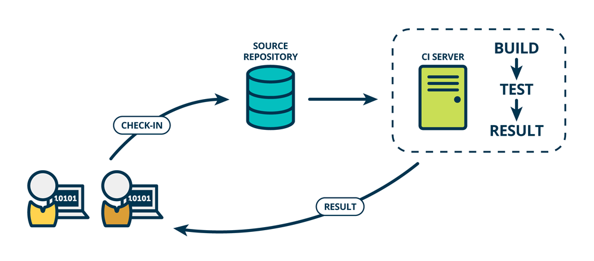

# DevEnv/ProductionEnv Deployment Automation

In this Project I have created an Automated System for deployment of application in Docker Container. The GitHub Repo for this project will have two branches, one for developer ie, <b>devenv</b> & another for master ie, <b>master</b>. The developer will commit to devenv branch and master will commit to master branch. As soon as the developer will commit, it will check for the website/application and if it is working properly then it will merge it with the production/master branch and will deploy it.

# Working Architecture and Use-Cases
In the above image you can see we have two persons sitting with Laptops and a Source Repository and then a CI Server from which the result is going back to one of the person sitting with Laptop. Let's assume one person is a developer of an organisation and another person is client. The Source Repository is GitHub in our case and CI Server is Jenkins. 
The working mechanism of this project is something like this. When our developer will push the code to github, it will be uplaoded to devenv branch as it is for developer branch. As soon as he will push the code, code from Jenkins will get triggered. If it is pushed in devenv branch then Docker Container for developer/testing environment will be launched and if it is pushed to master branch which is our production branch then Docker container for production environment will be launched. In this Project I made the testing part manually for devenv. If the testing of the developer environment is successfull and the new code doesn't give any error then, a Job is created which will automatically merge the devenv branch to production branch and deploy the application.

For the Video Demonstration of the Project <a href="https://www.youtube.com/watch?v=IJAjCQeu_q8"><b>click Here</b></a>

## Demo contact form setup

The portfolio demo includes `sendemail.php`. Before enabling its contact form, configure the **`CONTACT_RECIPIENT`** environment variable on the PHP server to a valid mailbox under your control, and configure the server's mail transport. For example, set it in your deployment environment (not in a committed source file).

The endpoint accepts only POST requests and returns JSON validation errors for missing name, email, message, or invalid email addresses. It HTML-escapes values inserted into the email template, prevents user input from becoming the sender address, and no longer sends contact submissions to the third-party template author's mailbox.

**Deployment note:** PHP's `mail()` still requires a configured mail transfer agent or equivalent transport. This demo has no spam protection, CSRF protection, or production email delivery integration; do not expose it publicly without those controls.
